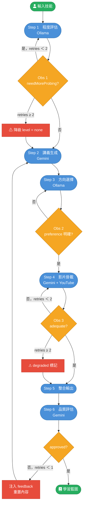
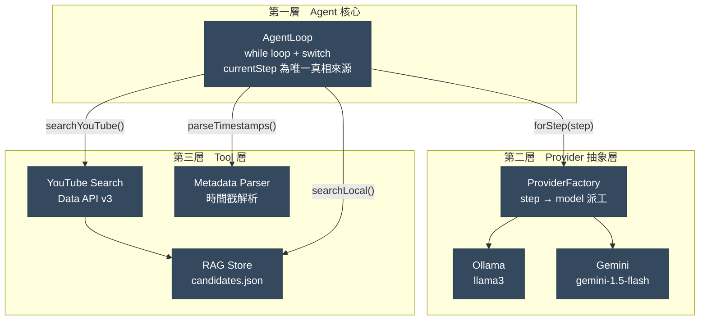

# SkillForge Agent

個人化技能學習導航系統。使用者說出想學的技能，Agent 評估程度、生成個人化講義，並掛載對應的 YouTube 影片片段（含時間戳），輸出完整學習藍圖。

---

## 架構概覽

採 **Generate-then-Retrieve** 架構，核心框架為 **ReAct（Reasoning and Acting）**。

### ReAct 主流程



### Step 4 影片掛載細節


### 三層架構



---

## 專案結構

```
SkillForge/
├── prompts/               # 各步驟 system prompt（md 檔）
│   ├── base.md            # 共用身分宣告 + 語言規則
│   ├── assess.md
│   ├── generate.md
│   ├── choose.md
│   ├── attach-4a.md
│   ├── attach-4b.md
│   └── reflect.md         # 品質評估：深度匹配、影片覆蓋、時間戳有效性
├── src/
│   ├── index.ts           # CLI 入口
│   ├── types.ts           # 所有型別定義
│   ├── agent/
│   │   ├── state.ts       # createInitialState()
│   │   ├── prompts.ts     # 讀取 md 檔，組合 LLMMessage[]
│   │   └── loop.ts        # AgentLoop（ReAct 主迴圈）
│   ├── provider/
│   │   ├── parseResponse.ts  # 容錯 JSON parser
│   │   ├── ollama.ts
│   │   ├── gemini.ts
│   │   └── factory.ts        # step → model 派工表
│   └── tools/
│       ├── youtubeSearch.ts  # YouTube Data API v3
│       ├── metadataParser.ts # 解析影片章節時間戳
│       └── ragStore.ts       # 本地 RAG：持久化 + 關鍵字搜尋
├── data/                  # 執行時自動建立，gitignored
│   └── candidates.json    # 跨 session 影片資源庫
├── .env.example
├── package.json
└── tsconfig.json
```

---

## 環境設定

### 需求

- Node.js 18+
- （可選）本地 [Ollama](https://ollama.com/) — assess / choose 步驟
- Google Gemini API Key — generate / attach 步驟
- YouTube Data API v3 Key — 影片搜尋

### 安裝

```bash
npm install
```

### 設定 API Keys

```bash
cp .env.example .env
```

編輯 `.env`：

```env
OLLAMA_BASE_URL=http://localhost:11434
OLLAMA_MODEL=llama3

GEMINI_API_KEY=your_gemini_api_key_here
GEMINI_MODEL=gemini-1.5-flash

YOUTUBE_API_KEY=your_youtube_api_key_here
```

> **沒有 Gemini Key？** Agent 會自動 fallback 到 Ollama 跑所有步驟。  
> **沒有 YouTube Key？** 影片掛載步驟會跳過，輸出仍含完整講義。

---

## 使用方式

```bash
# 直接指定技能
npx ts-node src/index.ts "TypeScript"

# 互動式輸入
npx ts-node src/index.ts

# 編譯後執行
npm run build
npm start "TypeScript"
```

### 執行流程範例

```
[step: assess]    [model: ollama/llama3]
Tell me about your experience with "TypeScript".
> I know JavaScript but never used TypeScript

[step: generate]  [model: gemini/gemini-1.5-flash]

[step: choose]    [model: ollama/llama3]
Lecture is ready! Do you prefer concept-first or practice-first?
> practice-first

[step: attach]    [model: gemini/gemini-1.5-flash]
  attaching video for: "Type Annotations"
  [4a query] "TypeScript Type Annotations tutorial"
  [search] 5 result(s) from YouTube      ← 第一次：打 API 並寫入本地庫

  attaching video for: "Interfaces"
  [4a query] "TypeScript Interfaces tutorial"
  [rag] 3 local result(s)                ← 第二次起：本地庫命中，不耗配額
  ...

[step: synthesize] [model: gemini/gemini-1.5-flash]
# Learning Blueprint: TypeScript
...

[step: reflect]   [model: gemini/gemini-1.5-flash]
[reflect] Blueprint looks good for a "some" level learner.
                                   ← approved → done
                                   ← 或 regenerate → 退回 generate 重做
```

---

## 開發指令

```bash
npm run dev         # ts-node 直接執行
npm run build       # 編譯到 dist/
npm run test        # 跑模擬測試（不需 API Key）
```

### 模擬測試

`src/test/agentLoop.test.ts` 使用 Mock Provider 和 Mock Search Function，不需要任何 API Key 即可跑完整的 6 步 ReAct 迴圈（含 reflect）驗證。

---

## 調整 Prompts

所有 system prompt 存放於 `prompts/` 目錄，直接編輯 md 檔即可，不需動程式碼。

支援 `{{placeholder}}` 語法動態注入 State 值：

| 檔案 | 可用變數 |
|------|---------|
| `assess.md` | `{{skill}}`, `{{knownConcepts}}` |
| `generate.md` | `{{skill}}`, `{{level}}`, `{{skipTopics}}`, `{{learningStyle}}` |
| `choose.md` | `{{skill}}`, `{{level}}` |
| `attach-4a.md` | — |
| `attach-4b.md` | — |
| `reflect.md` | — |

---

## YouTube 配額注意事項

YouTube Data API v3 預設每日 **10,000 units**，每次搜尋消耗 **100 units**。

Agent 內建三道防護：

| 層 | 機制 | 說明 |
|----|------|------|
| 1 | **Local RAG Store** | 跨 session 持久化，相同主題第二次起不打 API |
| 2 | **`candidateCache`** | session 內快取，同一 query 不重複呼叫 |
| 3 | **`searchRetries` 上限** | 每章節最多重搜 2 次，超過即降級標記 |

搜尋結果存於 `data/candidates.json`（自動建立，已 gitignore）。
