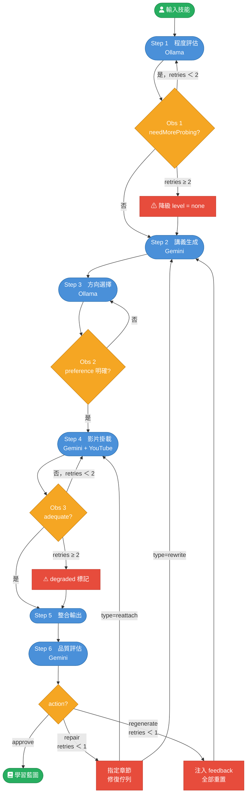

# SkillForge Agent — 教授討論文件

---

## 一、專案定位與動機

**問題陳述**：現有學習平台（Coursera、YouTube 推薦等）提供的是靜態、通用的內容，無法根據個別學習者的先備知識動態生成課程路徑。

**SkillForge 的解法**：以單一 LLM Agent 為核心，透過對話評估使用者程度，生成個人化講義，再從 YouTube 挑選對應影片片段，輸出完整學習藍圖。

**架構選擇**：採 **Generate-then-Retrieve** 策略——先用 LLM 的參數知識生成結構化講義，再事後掛載影片。這與傳統 RAG「先檢索、再生成」方向相反。

> **設計取捨**：Generate-then-Retrieve 的優勢是不依賴外部資料庫即可快速生成高品質課程內容，劣勢是 LLM 的知識有截止日期，也無法保證事實正確性。若換成先爬 YouTube 逐字稿再總結，回應時間會顯著拉長。

---

## 二、核心框架：ReAct

採用 **ReAct（Reasoning and Acting）** 模式，每輪迴圈包含：
- **Thought**：LLM 解釋推理依據（`thought` 欄位）
- **Action**：呼叫工具或執行步驟
- **Observation**：觀察結果，決定是否回退

三個 Observation 回退點（Obs1 / Obs2 / Obs3）是本系統有別於單純 Pipeline 的關鍵——讓 Agent 具備自我修正能力，而非線性走完就輸出。

---

## 三、系統架構

### 6 步驟主流程



### 三層架構

控制流單向由上往下，Agent 核心是唯一協調者，不直接碰網路。

| 層 | 職責 | 設計理由 |
|----|------|---------|
| **Agent 核心** | `while` 迴圈 + `switch`，讀寫 State | 把決策邏輯集中在一處，方便 debug 與測試 |
| **Provider 抽象層** | 統一 Ollama / Gemini 介面 | 隱藏不同 API 的差異，支援一鍵切換模型 |
| **Tool 層** | YouTube Search、Metadata Parser、RAG Store | 只放有外部呼叫的工具，純 prompt 步驟不包成 Tool |

---

## 四、關鍵設計決策

### 4.1 不使用 LangChain / LangGraph

刻意手寫 `while` 迴圈，理由：
- 保留每一步的完全透明度（State 是純 JSON，隨時可 inspect）
- 框架的抽象往往隱藏了 Prompt 細節和回退邏輯
- 學習目的：理解 ReAct 的底層機制

### 4.2 每步一個獨立 Prompt

系統不是「一個 system prompt 用到底」，而是每步有各自的 Prompt 檔案（`prompts/`），共用一個 base prompt。

理由：各步驟在做本質不同的事（提問者 / 作者 / 規劃者 / 評審者），輸出格式完全不同。

### 4.3 State 純資料原則

`AgentState` 只包含字串、數字、布林、陣列——**無函式、無 class instance、無 Date 物件**。任何時刻都能 `JSON.stringify(state)` 存檔，方便 debug 與斷點續跑。

### 4.4 Step 6 的 Self-Reflection

傳統 pipeline 輸出即完成，本系統在整合輸出後加一個品質評估步驟（Step 6），讓 LLM 評估三個維度：
- 講義深度是否符合 level
- 影片覆蓋率（降級章節比例）
- 時間戳有效性

評估結果可觸發三種 action：`approve`（完成）、`repair`（只修指定章節）、`regenerate`（全部重做）。

### 4.5 Generate-then-Retrieve 中的 RAG

Step 4 的影片搜尋加入本地 RAG Store（`data/candidates.json`），查找優先順序：

```
Session Cache → Local RAG Store → YouTube Data API v3 → 持久化
```

這讓相同主題第二次執行時完全不消耗 YouTube 配額（每次搜尋 100 units）。

---

## 五、與標準 Agent 架構的對照

對照參考架構（Module I–IV + Self-Reflection），本系統現況：

| 模組 | 對照項目 | 實作狀況 |
|------|---------|---------|
| Module I：Profile | 使用者畫像 | ✅ skill / level / preference；❌ 無明確 constraints 欄位 |
| Module II：Memory | Short-term | ✅ `assessHistory`（多輪對話）；❌ generate/attach 無對話歷史 |
| Module II：Memory | Long-term RAG | ✅ 影片候選持久化；❌ 使用者偏好不跨 session |
| Module III：Planning | Task Decomposition | ⚠️ 固定 6 步，無動態分解；有 `thought` 欄位做輕量 CoT |
| Module III：Planning | Feedback Iteration | ✅ repair/regenerate 分支；但非樹狀搜索 |
| Module IV：Action | Tool 使用 | ✅ YouTube Search + RAG；❌ 無 Web Search、Code Execution |
| Self-Reflection | 軌跡評估 | ✅ Step 6 評估深度/覆蓋/時間戳；❌ 無 schema 驗證、無失敗歸因 |

---

## 六、目前限制與未來方向

### 已知限制

1. **使用者資料不持久**：每次執行重頭評估，不記得上次的 level 和 preference
2. **RAG 為關鍵字匹配**：閾值為「半數詞匹配」，無語意向量，難以處理同義詞
3. **Planning 線性固定**：6 步順序不會因技能類型調整（例如實務技能不需 choose 步驟）
4. **無事實驗證**：講義由 LLM 參數知識生成，存在幻覺風險，未加任何驗證機制
5. **單使用者設計**：State 為單一 JSON，未考慮多使用者並發

### 潛在延伸方向

| 方向 | 技術路徑 |
|------|---------|
| 使用者偏好持久化 | 把 profile 存入 `data/users/<id>.json`，再次執行時載入跳過 assess |
| 語意 RAG | 用 Embedding 模型（如 `nomic-embed-text`）替換關鍵字匹配 |
| 動態步驟規劃 | 在 generate 前加 CoT 規劃步驟，LLM 決定哪些步驟可跳過 |
| 事實驗證 | 對 LLM 生成的內容進行 Grounding Check（如引用 Wikipedia） |
| 評估指標 | 定義 BLEU/ROUGE 或人工評估的學習路徑品質指標 |

---

## 七、可能的討論問題

**設計選擇類**
- 為何選擇 Generate-then-Retrieve 而非先檢索再生成？在哪些情境下這個選擇會失敗？
- ReAct 的三個 Observation 回退點如何比較傳統 Pipeline 的錯誤處理？
- 不使用 LangChain 的代價是什麼？在何時會需要引入框架？

**技術挑戰類**
- YouTube 配額限制如何影響系統設計決策？RAG Store 是否是正確的解法？
- `adequate` 判斷完全依賴 LLM，如何確保評估一致性？
- State 純資料原則帶來了什麼測試優勢？

**延伸思考類**
- 如何衡量這個系統生成的學習藍圖品質？有哪些可量化的指標？
- 若要支援多使用者，State 結構需要如何改動？
- Self-Reflection 步驟的 prompt 設計如何避免 LLM 永遠 approve（過於寬鬆）或永遠 regenerate（過於嚴格）？
